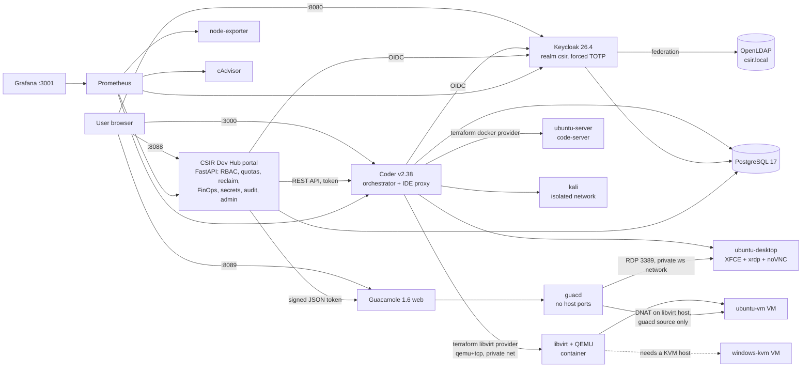

# CSIR Software Development Hub (CSIR Dev Hub): proof of concept

Self-service, on-prem developer workspaces for CSIR:
- containers with VS Code (browser or desktop)
- full Linux desktops and specialist OSes (Kali, Windows on KVM), reached through brokered RDP
- LDAP/OIDC SSO with forced MFA, six roles, quotas, idle reclaim, FinOps, network profiles, secrets injection, audit and observability

It is based on the Technical Annex and Implementation Plan **CSIR/DS/ICSC/SDL/2026/001/E**. See
[docs/annex-mapping.md](docs/annex-mapping.md) for what is implemented, stubbed or planned.

**Project lead:** Ndabezinhle Hlongwane (Technical Lead, Software Development)

## Architecture



Each workspace gets its own Docker bridge network (`csir-ws-<owner>-<ws>`):
- **dev:** egress allowed.
- **isolated:** `internal` network with no egress. A per-workspace socat gateway relays only to Coder.
- **windows-licensed:** the libvirt network `csir-windows-licensed` (routed to KMS/AD on-prem). Workspaces on it check out a seat from the licence broker.

VM workspaces use libvirt networks instead: `csir-dev` (NAT), `csir-isolated` (no forward) and `csir-windows-licensed`.

guacd is attached to a workspace network only when its owner opens an RDP session from the portal.

## Components and ports

| Service | Port (host) | Purpose |
|---|---|---|
| Coder | 3000 (metrics 2112 internal) | Workspace orchestration, IDE/app proxy, templates |
| Portal / admin console | 8088 | Self-service and admin: users, workspaces, images (Trivy scans, approvals), quotas, licences, reclaim, FinOps, billing, KVM, audit, health |
| Keycloak | 8080 | OIDC IdP, LDAP federation, MFA (realm `csir`) |
| Guacamole | 8089 (`/guacamole/`) | Brokered RDP (guacd has no published ports) |
| Grafana | 3001 | Dashboard "CSIR Dev Hub - Platform Overview" |
| Prometheus | 9090 | Metrics and alert rules |
| OpenLDAP, Postgres, guacd, node-exporter, cAdvisor | internal only | |
| libvirt (libvirtd TCP 16509) | internal only (`csir-devhub-core`) | VM workspaces (overlay `docker-compose.kvm.yml`, `KVM_ENABLED=true`) |

## Repository layout

```
docker-compose.yml            core stack (postgres, coder, keycloak, openldap, prometheus, grafana, exporters, portal)
docker-compose.oidc.yml       Coder OIDC overlay (added by scripts/dc.sh once OIDC_ISSUER_URL is set)
docker-compose.guacamole.yml  guacd + guacamole overlay (added when GUACAMOLE_ENABLED=true)
docker-compose.kvm.yml        libvirt/QEMU overlay (added when KVM_ENABLED=true; KVM_ACCEL=tcg|kvm)
.env.example                  non-secret settings (copy to .env)
secrets/                      generated secrets: devhub.env (chmod 600, git-ignored)
identity/roles.json           six roles -> LDAP groups -> Coder roles, demo users
scripts/                      start/stop, dc.sh wrapper, bootstrap (identity, guacamole), build-images, e2e tests,
                              kvm-publish-image, test-kvm, backup, restore
stack/                        postgres, prometheus, grafana, guacamole schema, libvirt, coder (+mkisofs), portal
packer/                       golden images: ubuntu-golden (built), windows-2022 (Microsoft eval ISO; needs KVM)
ops/systemd/                  backup service + timer
images/                       workspace images: ubuntu-server (24.04/26.04), ubuntu-desktop, kali
templates/                    Coder Terraform templates: ubuntu-server, ubuntu-desktop, kali, ubuntu-vm, windows-kvm
docs/                         auth-mfa, ide-options, guacamole-rdp, annex-mapping, extending-kvm, sizing, backup,
                              licensing-images-billing
.github/workflows/ci.yml      CI: compose config, terraform fmt/validate, hadolint, portal/libvirt/coder builds,
                              Trivy image + config scans (report-only), packer validate
```

## Prerequisites
- Linux host with Docker Engine and Compose v2, about 16 GB RAM (PoC), Python 3 and curl.
- `/dev/kvm` with working (nested) virtualisation for Windows VMs. Linux VMs also run without it, using QEMU TCG
  (`KVM_ACCEL=tcg`, the PoC default).
- The `coder` CLI (matching v2.38) for pushing templates, and Terraform 1.14 for local validation.
- On this PoC box the Docker daemon is at `DOCKER_HOST=tcp://127.0.0.1:2375`, and the scripts default to it.
  Elsewhere, export `DOCKER_HOST=unix:///var/run/docker.sock`.

## Start / stop

```bash
cd /workspace/csir-devhub
cp -n .env.example .env            # set HOST_IP to an address browsers AND containers can reach
./scripts/build-images.sh          # workspace images (ubuntu-server 24.04/26.04, ubuntu-desktop, kali)
./scripts/start.sh                 # secrets, compose up, identity + MFA bootstrap, guacamole, push templates, status
./scripts/stop.sh                  # stop the stack (data kept); --workspaces also stops running workspaces
./scripts/dc.sh ps                 # any docker compose command, with env, secrets and overlays applied
```

First-time Coder setup (only on a brand-new database):
1. Create the first user in the Coder UI, or run `coder login http://$HOST_IP:3000`.
2. Create a portal API token:
   ```bash
   coder tokens create --name devhub-portal --lifetime 8760h
   ```
3. Store the token as `CODER_SESSION_TOKEN` in `secrets/devhub.env`.
4. Restart the portal with `./scripts/dc.sh up -d portal`.

**Credentials:** every generated password and key is in `secrets/devhub.env` (chmod 600, git-ignored). The file
includes the Coder admin, Keycloak admin, Grafana admin, guacadmin and the shared LDAP demo-user password. Values are never printed by the scripts.

## Demo walkthrough (PoC box; HOST = 172.17.0.1)

1. **Health:** open `http://HOST:8088/admin/health`. Coder, Keycloak, Prometheus and Guacamole should show green.
2. **SSO + forced MFA:** at `http://HOST:8088`, choose "Sign in with CSIR SSO" and sign in as LDAP user `engineer1`
   with `LDAP_DEMO_PASSWORD`. Keycloak forces TOTP enrolment: scan the QR with Google Authenticator, FreeOTP or Ente
   Auth. Then sign out and back in to get the OTP challenge. The same applies to Coder ("Sign in with CSIR SSO
   (Keycloak / LDAP)") at `http://HOST:3000`. Scripted proof: `python3 scripts/test-mfa.py engineer2`.
3. **Roles:** `engineer1` sees only their own workspaces, and admin pages return 403. Sign in locally as `admin`
   (`CODER_ADMIN_PASSWORD`) or via SSO as `ndabezinhle` (hub-admin) to see Users, Workspaces, Images, Quotas, Reclaim,
   FinOps and Audit.
4. **Provision:** on Home, create a workspace:
   - template: ubuntu-server (24.04 or 26.04)
   - size: 2 vCPU / 4 GB
   - network: dev

   Open **VS Code** (code-server in the browser) or **VS Code Desktop** (Coder Remote extension).
5. **Quota / policy:** request 16 GB as an engineer, or the `windows-licensed` profile on Ubuntu. Both are denied, and the denial is audited.
6. **Secrets:** under Secrets, add `MY_TOKEN`. In the workspace terminal, `cat /run/csir-secrets/MY_TOKEN`. The file is read-only.
7. **Desktop + brokered RDP:** create an `ubuntu-desktop` workspace and click **Desktop (RDP)**. The portal attaches guacd
   to the workspace network and opens Guacamole with a 5-minute signed token. Or use the **noVNC** app in Coder.
   Proof: `python3 scripts/test-rdp.py demo-desktop`.
8. **Kali (isolated):** run `coder create <you>/range1 -t kali --use-parameter-defaults`. It has no internet egress,
   and nmap and tcpdump work.
9. **Observability:** open Grafana at `http://HOST:3001` (dashboard *CSIR Dev Hub - Platform Overview*) and
   Prometheus targets at `http://HOST:9090/targets`.
10. **Audit:** open `http://HOST:8088/admin/audit`. It can filter by actor or action and export CSV.
11. **VM workspace (libvirt):** `admin/demo-vm` (template `ubuntu-vm`). Run `coder ssh admin/demo-vm`, or open it from the
    portal (terminal, VS Code, code-server, **Desktop (RDP)** through Guacamole). Admin → **KVM** shows capacity,
    domains, power actions and snapshots. Proofs: `scripts/test-kvm.sh` and `python3 scripts/test-rdp.py demo-vm`.
12. **Licences:** Admin → **Licences** shows seat pools, who holds which seat, resize, and manual checkout/return. A
    `windows-licensed` workspace checks out a seat on create and returns it on delete. Role and project caps apply.
13. **Images:** Admin → **Images** → Scan runs Trivy on an image. The image-publisher role approves it. Publishing a catalog
    item is blocked while criticals exceed `max_critical`, unless a hub-admin records a time-limited risk acceptance.
14. **Billing:** Admin → **Billing**, or `GET /api/billing/usage?from=2026-11-01&to=2026-11-30&group_by=user&format=csv`.
15. **Backup:** `scripts/backup.sh`, then `scripts/restore.sh latest --verify` (see docs/backup.md).

End-to-end portal test: `python3 scripts/test-portal.py` covers 49 checks (auth, RBAC, provisioning, quotas, network
policy, IDE health, secrets, audit, licence broker, image scanning and approval, billing, KVM, backup status).

## Verified vs stubbed (summary)
- **Verified:**
  - Coder with Docker templates (Ubuntu Server 24.04/26.04, Ubuntu Desktop, Kali) and a persistent home
  - code-server and VS Code Desktop
  - Keycloak OIDC, OpenLDAP federation and forced TOTP MFA
  - the six roles, the portal (quotas, reclaim, FinOps, secrets, audit, admin console) and the isolated network profile
  - Guacamole RDP with session recording, and Prometheus/Grafana
  - **VM workspaces on libvirt/QEMU:**
    - the `ubuntu-vm` template; `demo-vm` with the agent, ssh, code-server and brokered RDP
    - the Packer Ubuntu golden image
    - the portal KVM admin page
    - runs under TCG, because nested KVM is broken on this box
  - **licence broker:** seat pools, checkout and return tied to the workspace lifecycle, reconcile, caps, audit, admin page
  - **image scanning:** Trivy in CI (report-only) and in the portal; publisher approval; publishing blocked on criticals
  - **billing export:** CSV/JSON per user, project or workspace, from Coder and Prometheus
  - **backup and restore:** test restore verified
  - CI is green
- **Partial:** Windows on KVM.
  - The `windows-kvm` template is pushed to Coder.
  - The `packer/windows-2022` pipeline (Microsoft evaluation ISO) validates.
  - Neither is built: the PoC box's nested KVM crashes the host kernel, so a KVM host is needed (docs/extending-kvm.md).
- **Stubbed:** the KMS host (`kms.csir.local`) and off-host backup replication.
- **Planned:** HA and TLS with wildcard apps, AD, WebAuthn, Loki, recording retention.

See [docs/annex-mapping.md](docs/annex-mapping.md).

## Further docs
- [docs/auth-mfa.md](docs/auth-mfa.md): Keycloak, LDAP and MFA design and demo
- [docs/ide-options.md](docs/ide-options.md): code-server, VS Code Desktop, JetBrains, desktops
- [docs/guacamole-rdp.md](docs/guacamole-rdp.md): brokered RDP
- [docs/extending-kvm.md](docs/extending-kvm.md): full Coder + KVM on-prem, Windows
- [docs/sizing.md](docs/sizing.md): tiers 30/40/60/70 and per-workspace limits
- [docs/backup.md](docs/backup.md): backup, retention, restore verification, timer
- [docs/licensing-images-billing.md](docs/licensing-images-billing.md): licence broker, image scanning and approval, billing export

## Pushing to GitHub

The remote is `https://github.com/uNdabezinhle/csir-dev-hub.git` (branch `main`).

```bash
git remote add origin https://github.com/uNdabezinhle/csir-dev-hub.git   # once
# Push with a token from the environment, without storing it anywhere:
git -c credential.helper= \
    -c "credential.helper=!f() { echo username=x-access-token; echo password=\$GITHUB_TOKEN; }; f" \
    push origin main
```

- Use a fine-grained PAT scoped to this repo, with **Contents: read/write** and **Workflows: read/write**. The second
  is required because the push includes `.github/workflows/ci.yml`.
- Before committing, confirm nothing secret is staged:
  ```bash
  git diff --cached --name-only | grep -E '^secrets/|\.env$|\.pem$|\.key$'
  ```
  This should print nothing. `secrets/` and `.env` are git-ignored.
- CI runs on every push and pull request (`.github/workflows/ci.yml`). Consider branch protection on `main` that
  requires the `compose`, `terraform` and `portal` checks.
